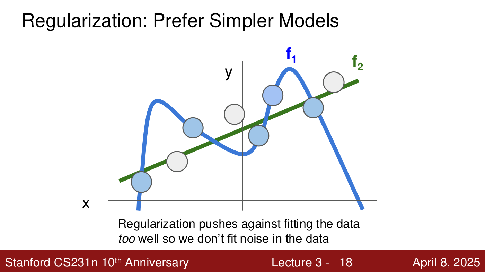
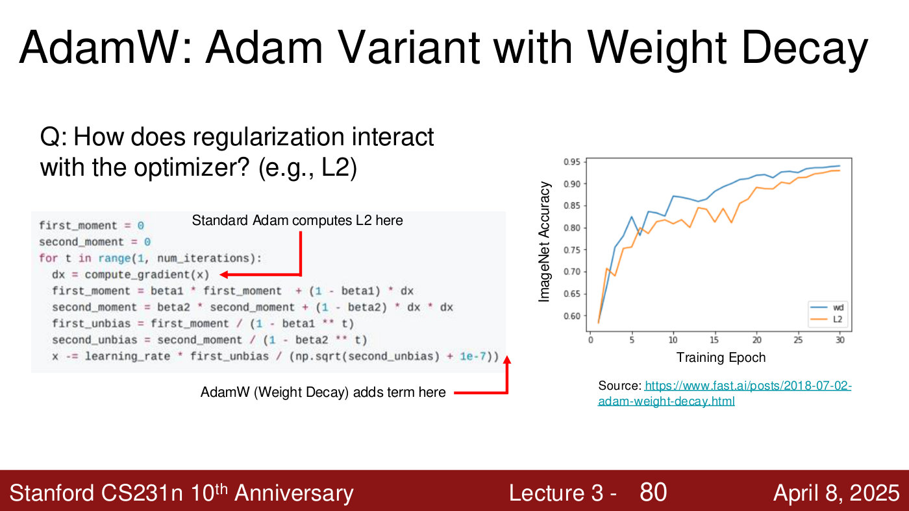
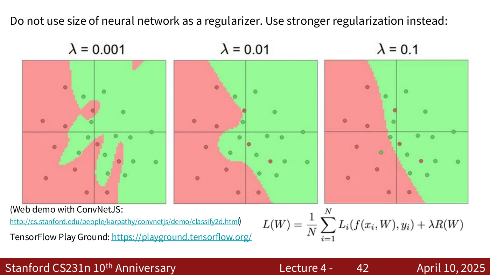

# Regularization

**Regularization** is a term added to the loss that deliberately makes a model do worse on its
training data so that it does better on data it has not seen. In lecture 3's words, it is there to
"prevent the model from doing too well on training data" (lecture 3, ≈11:43). This page covers what
CS231N says about it so far: the regularized loss, L2, L1 and elastic net, which weights each
prefers, why regularize, how regularization meets the optimiser in AdamW, and why a network's
capacity is controlled with the regularization strength rather than its size.

Covered in: [Lecture 3](03-regularization-optimization.md#regularization);
[Lecture 4](04-neural-networks-backpropagation.md#choosing-the-networks-size) adds the rule about
network size. Later lectures add
more complex regularizers (dropout, batch normalization and others); this knowledge base does not
cover them yet.

## The regularized loss

With $N$ training examples $(x_i, y_i)$, a score function $f(x_i, W)$ and a per-example loss $L_i$
(see [loss functions](loss-functions.md)), the full loss is the data loss plus a regularization term
$R(W)$ weighted by $\lambda$ (lecture 3, slides 14–15):

$$L(W) = \frac{1}{N} \sum_{i=1}^{N} L_i(f(x_i, W), y_i) + \lambda R(W)$$

The data loss says the "model predictions should match training data"; the regularization term
pulls the other way. Training minimises the sum, so a weight that adds to $R(W)$ without helping the
data loss gets pushed toward zero (lecture 3, ≈17:06–17:52).

$\lambda$ is the **regularization strength**, a hyperparameter (lecture 3, slide 20): 0 means no
regularization, and larger values regularize more strongly. Like any hyperparameter it is chosen
with a validation set (lecture 3, ≈14:01–14:47; see
[hyperparameters and validation](hyperparameters-and-validation.md)).

## Prefer simpler models

The intuition is a toy regression with five points. A wiggly curve $f_1$ through every point has
almost no data loss; a straight line $f_2$ near the points fits them less well. New points from the
same distribution land near the line, not the curve (lecture 3, ≈13:14–14:01).

"Regularization pushes against fitting the data too well so we don't fit noise in the data"
(lecture 3, slide 18). The deck connects it to Occam's razor: among competing hypotheses, the
simplest is the best (lecture 3, slide 19). But regularization does not always produce a simpler
model. Dropout, for example, makes a model more complex and still improves test performance; what
every regularizer shares is trading training performance for test performance (lecture 3,
≈23:15–24:01).

*Lecture 3, slide 18 — Regularization: Prefer Simpler Models. [Deck](https://cs231n.stanford.edu/slides/2025/lecture_3.pdf)*

## L2, L1 and elastic net

Writing $W_{k,l}$ for the entry in row $k$ and column $l$ of $W$, and $\beta$ for the weight on the
L2 part of the elastic net (lecture 3, slide 21):

$$R(W) = \sum_k \sum_l W_{k,l}^2 \qquad \text{(L2)}$$

$$R(W) = \sum_k \sum_l \lvert W_{k,l} \rvert \qquad \text{(L1)}$$

$$R(W) = \sum_k \sum_l \beta W_{k,l}^2 + \lvert W_{k,l} \rvert \qquad \text{(elastic net)}$$

**L2 spreads weights out; L1 makes them sparse.** Squaring shrinks a small weight further (0.001
becomes $10^{-6}$), so L2 hardly penalises small non-zero weights and tends to leave many small
values. L1 penalises a weight in proportion to its size, so it tends to drive many weights to zero
or very close to it (lecture 3, ≈15:33–16:20).

A worked example (lecture 3, slides 24–26): with $x = [1, 1, 1, 1]$, the weights
$w_1 = [1, 0, 0, 0]$ and $w_2 = [0.25, 0.25, 0.25, 0.25]$ give the same score, $w_1^T x = w_2^T x = 1$.
L2 prefers $w_2$: its penalty is $4 \times 0.25^2 = 0.25$, a quarter of $w_1$'s 1. Under L1 the two
are tied, since $4 \times 0.25 = 1$ as well; the deck asks which one L1 would prefer without
printing an answer, and the lecturer calls it a trick question (lecture 3, ≈20:10–20:57).

The deck lists dropout, batch normalization, stochastic depth and fractional pooling as "more
complex" regularizers (lecture 3, slide 22).

## Why regularize?

Three reasons (lecture 3, slide 23): to express preferences over weights (spread out, or sparse);
to make the model simple so it works on test data; and to improve optimisation by adding
curvature. On the last, L2 adds a convex, parabola-shaped term, which has useful optimisation
properties that the course does not go into (lecture 3, ≈18:38–19:23).

## Regularization inside the optimiser: L2 vs. weight decay

Adding $\lambda R(W)$ to the loss means its gradient enters every update. With adaptive optimisers
that matters. **Standard Adam computes the L2 term inside the gradient**, so it is used during the
moment calculations; **AdamW instead adds weight decay at the end of the update**, after the
moments (lecture 3, slides 78–79). The reason to separate them is so that the optimiser's
velocities and moments follow the loss landscape rather than the weight values (lecture 3,
≈58:27–59:12).

On the deck's chart, from a fast.ai post, weight decay ends at about 0.94 ImageNet accuracy against
about 0.93 for L2 (lecture 3, slide 80). Under many settings AdamW works slightly better, and the
lecturer notes that Meta's Llama models use it (lecture 3, ≈57:41–58:27). See
[optimizers](optimizers.md#adamw).

*Lecture 3, slide 80 — where each variant applies regularization, and ImageNet accuracy over 30 epochs for weight decay ("wd", blue) and L2 (orange); wd ends at about 0.94 against about 0.93. Chart from fast.ai. [Deck](https://cs231n.stanford.edu/slides/2025/lecture_3.pdf)*

## The regularization strength and the network's size

For [neural networks](neural-networks.md), lecture 4's rule of thumb is: "Do not use size of neural
network as a regularizer. Use stronger regularization instead" (lecture 4, slide 42). The slide
shows one network trained at $\lambda = 0.001$, $0.01$ and $0.1$: as $\lambda$ grows, its decision
boundary smooths from finger-like protrusions around individual points to a nearly straight line.
"What we often do is go with a bit of a bigger network than we need" and then tune the
regularization strength, rather than tuning the size (lecture 4, ≈29:48–30:34).

*Lecture 4, slide 42 — one network at regularization strengths λ = 0.001, 0.01 and 0.1: stronger regularization smooths the boundary, down to a nearly straight line. [Deck](https://cs231n.stanford.edu/slides/2025/lecture_4.pdf)*

A larger $\lambda$ underfits because the regularizer acts on the weights: the more it contributes to
the loss, the less freedom the weights have, and "less freedom equals more generic boundaries"
(lecture 4, ≈31:20). Nor is more regularization always better. The data loss is about predicting
the right output, and the regularizer only about the weights, so "a regularizer is always good,
but nothing is good if you use too much of it" (lecture 4, ≈32:06).

## Related pages

- [Neural networks](neural-networks.md) — the models whose capacity this controls.

- [Loss functions](loss-functions.md) — the data-loss half of the objective.
- [Optimizers](optimizers.md) — how the regularized loss is minimised.
- [Hyperparameters and validation](hyperparameters-and-validation.md) — how to choose $\lambda$.
