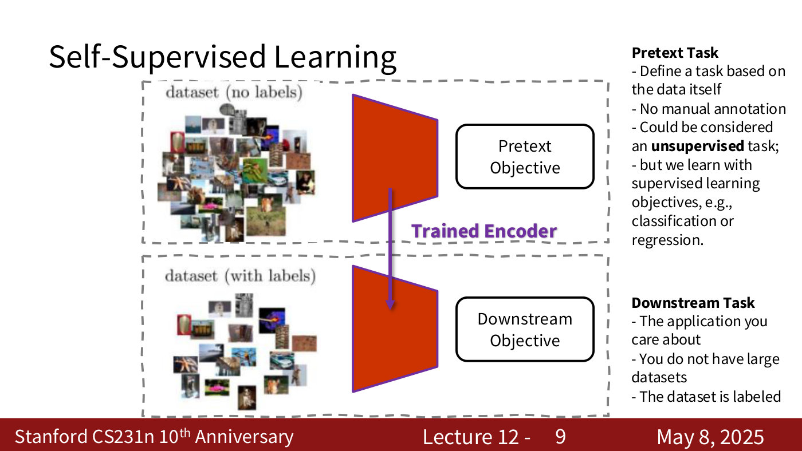
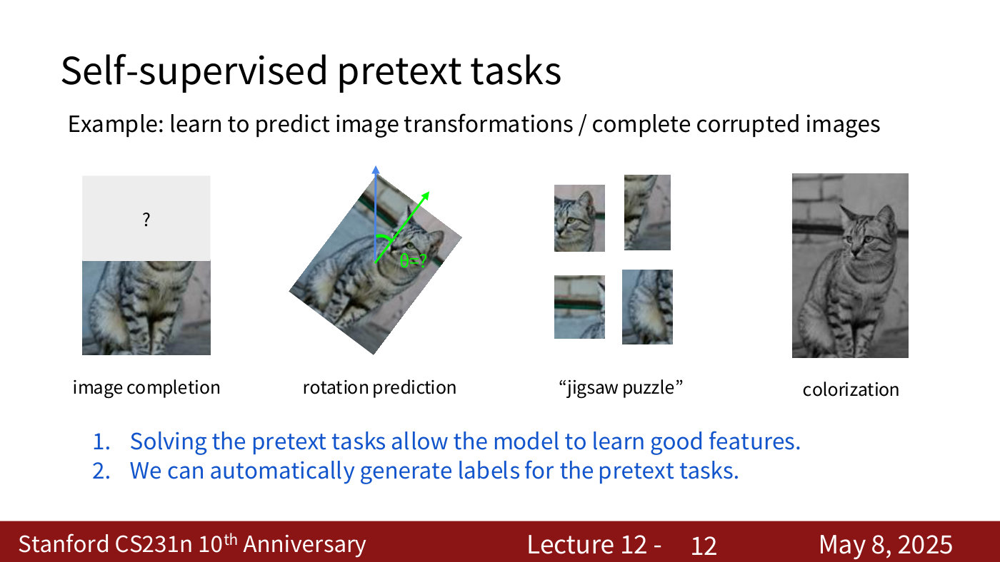
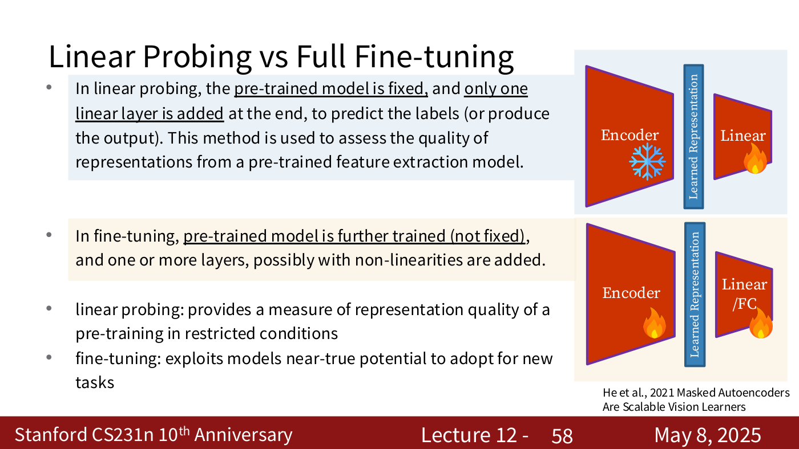
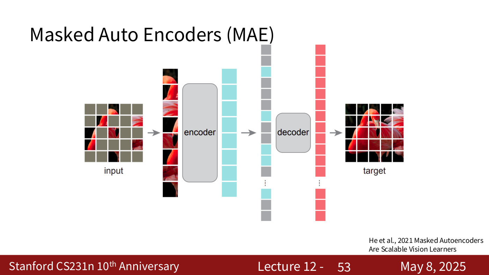
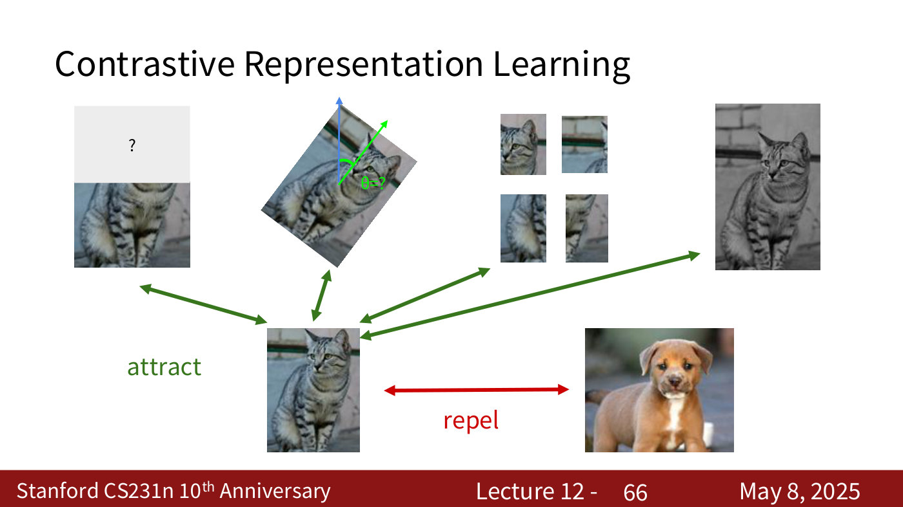
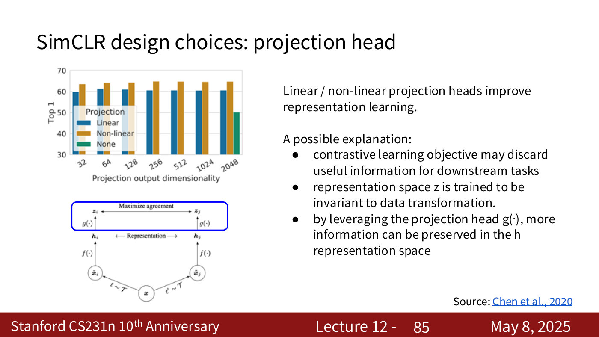
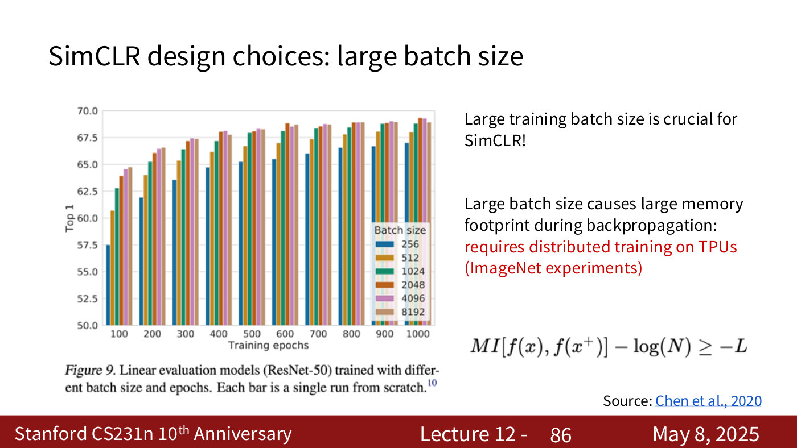
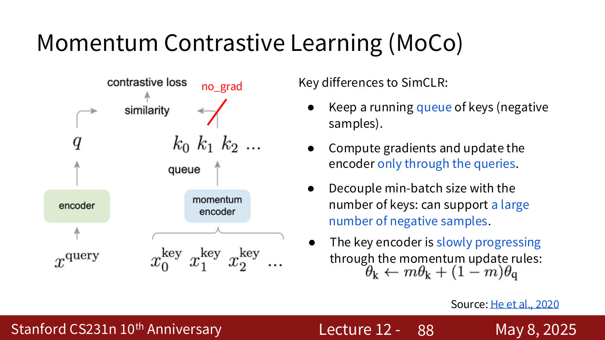
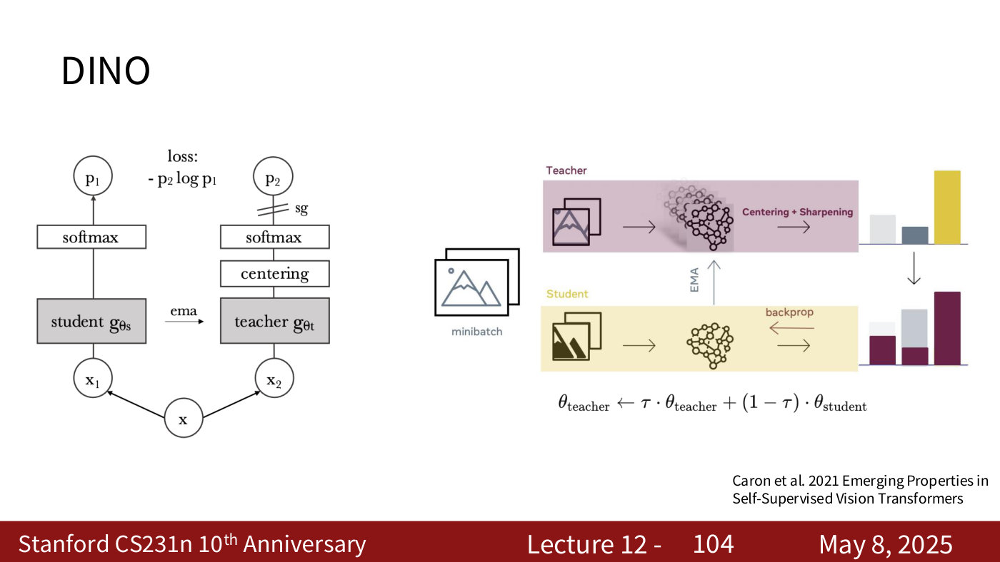
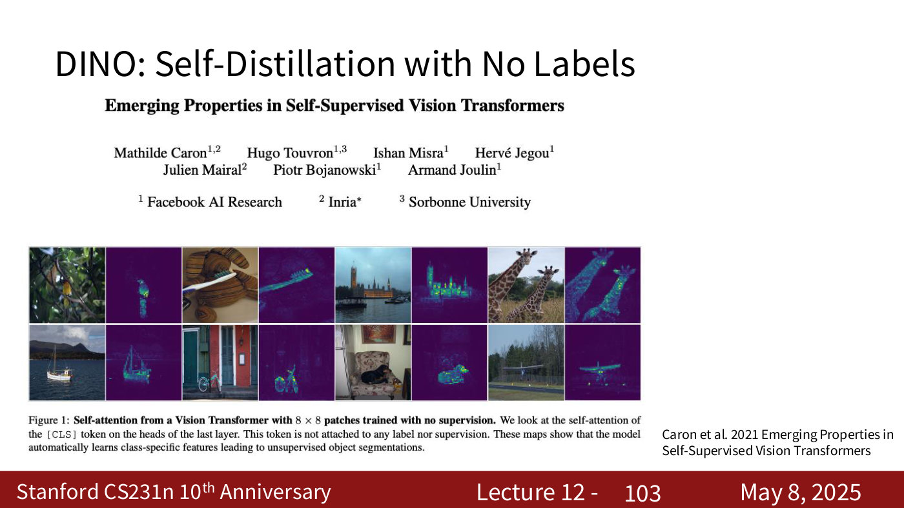

# Self-supervised learning

Self-supervised learning trains a network without manual labels by inventing a task whose labels come from the data itself. The course treats it in [lecture 12](12-self-supervised-learning.md) (May 8, 2025), and previews it in [lecture 1](01-introduction.md). Citations "lecture 12, slide N" are to the [lecture 12 slide file](../raw/slides/12-self-supervised-learning.md), and timestamps to its [transcript](../raw/transcripts/12-self-supervised-learning.md). The lecture's recording stops after MoCo v2, so what this page says about CPC, MoCo v3 and DINO comes from the slides alone.

## Why: features are good, labels are expensive

A trained network's features are good image representations: nearest neighbours in feature space share a category where nearest neighbours in pixel space only look alike, and a linear model on the features can classify (lecture 12, ≈0:53–3:12; see [visualizing networks](visualizing-networks.md)). But training that network from images to class labels needs a lot of labelled data, which at scale means people labelling images, or pixels, one by one (lecture 12, ≈3:12–4:00). Self-supervised learning keeps the features and drops the labels.

## Pretext task, then downstream task

Training has two stages (lecture 12, slide 9). The **pretext task** is defined on a large unlabelled data set, with labels generated automatically from the data; it "could be considered an unsupervised task", "but we learn with supervised learning objectives, e.g., classification or regression." The encoder it trains is then carried over to the **downstream task**, "the application you care about", which has a smaller labelled data set. Downstream, the pretext task's decoder or classifier is replaced by a small head trained on the labels. This is [transfer learning](transfer-learning.md) with the pre-training done without labels.

*Lecture 12, slide 9 — the two stages: a pretext objective on unlabelled data trains the encoder, which is carried over to the downstream objective on labelled data. [Deck](https://cs231n.stanford.edu/slides/2025/lecture_12.pdf)*

A good pretext task must make the model learn good features, and its labels must be free to generate (lecture 12, slide 12). The pretext performance itself is not the goal: "the most important aspect that we are after is the performance on the downstream task" (lecture 12, ≈11:49).

*Lecture 12, slide 12 — four pretext tasks on one cat photo: image completion, rotation prediction, jigsaw puzzle and colourisation. [Deck](https://cs231n.stanford.edu/slides/2025/lecture_12.pdf)*

There are two standard ways to use the encoder downstream (lecture 12, slide 58). **Linear probing** freezes the encoder and trains one linear layer, which measures the quality of the representation. **Fine-tuning** trains the encoder as well, possibly with more added layers, which is how the most accuracy is reached.

*Lecture 12, slide 58 — linear probing freezes the encoder (snowflake) and trains one linear layer; fine-tuning trains the encoder too (flames). [Deck](https://cs231n.stanford.edu/slides/2025/lecture_12.pdf)*

## Pretext tasks from image transformations

The first family transforms an image and asks the network to undo or recognise the transformation. In each case the label is free because the transformation was chosen by the program.

| Pretext task | The network predicts | Output | In lecture 12 |
| --- | --- | --- | --- |
| Rotation (RotNet, Gidaris et al. 2018) | which of 0, 90, 180, 270 degrees the image was rotated by | 4-way classification | [rotations](12-self-supervised-learning.md#predicting-rotations) |
| Relative patch location (Doersch et al. 2015) | where a patch sits relative to the centre patch of a 3 x 3 grid | 8-way classification | [relative patch location](12-self-supervised-learning.md#relative-patch-location) |
| Jigsaw puzzle (Noroozi and Favaro 2016) | which of 64 chosen permutations shuffled the nine patches | 64-way classification | [jigsaw puzzles](12-self-supervised-learning.md#jigsaw-puzzles) |
| Inpainting (context encoders, Pathak et al. 2016) | the pixels of a masked region | an image region, with a reconstruction and an adversarial loss | [inpainting](12-self-supervised-learning.md#inpainting) |
| Colourisation (Zhang et al.) | the ab colour channels from the L lightness channel | the colour channels | [colourisation](12-self-supervised-learning.md#colourisation) |
| Split-brain autoencoder | each of two channel sets from the other | both channel sets | [split-brain](12-self-supervised-learning.md#split-brain-autoencoders) |
| Video colourisation (Vondrick et al. 2018) | a target frame's colours, copied from a reference frame through attention | colours, and tracking as a by-product | [video](12-self-supervised-learning.md#colourising-video-and-tracking) |
| Masked autoencoder (MAE, He et al. 2021) | the pixels of 75% of an image's patches, masked at random | an image | [MAE](12-self-supervised-learning.md#masked-autoencoders-mae) |

Transferred to Pascal VOC 2007, these methods close much of the gap between random initialization and supervised ImageNet pre-training without reaching the latter. Rotation pre-training gives 72.97 %mAP classification against 53.3 from random initialization and 79.9 from ImageNet labels (lecture 12, slide 23).

The deck names two problems with the family as a whole: "coming up with individual pretext tasks is tedious", and "the learned representations may not be general", since they "may be tied to a specific pretext task" (lecture 12, slides 62–63).

## Masked autoencoders

The masked autoencoder is the reconstruction method the lecturer calls one of the most used for pre-training today (lecture 12, ≈46:01, ≈58:26). It divides the image into patches, masks 75% of them at random, and passes only the visible quarter through a large ViT encoder. A smaller decoder receives the encoded patches with a shared, learned mask token in each masked place, and reconstructs the pixels; the mean squared error is computed only on the masked patches. The decoder is discarded after pre-training, so the two halves are deliberately asymmetric (lecture 12, slides 53–57). High masking is what makes the task "challenging and meaningful" (lecture 12, slide 54).

*Lecture 12, slide 53 — MAE: only the visible patches (8 of 25 here) go through the large encoder; mask tokens fill the gaps for the smaller decoder, which reconstructs every patch. [Deck](https://cs231n.stanford.edu/slides/2025/lecture_12.pdf)*

## Contrastive learning

The second family gives up on predicting a transformation and asks only that the representation say which images belong together. Transformed views of the same image (positives, $x^{+}$) should attract the reference $x$, and other images (negatives, $x^{-}$) should be repelled (lecture 12, slide 66).

*Lecture 12, slide 66 — contrastive learning: transformed views of the same cat attract, and a different object repels. [Deck](https://cs231n.stanford.edu/slides/2025/lecture_12.pdf)*

In symbols, with an encoder $f$, what we want is

$$\text{score}(f(x), f(x^{+})) \gg \text{score}(f(x), f(x^{-}))$$

(lecture 12, slide 70). With one positive and $N-1$ negatives and a score function $s$, the **InfoNCE** loss is

$$L = -\mathbb{E}_ {X}\left[\log \frac{\exp(s(f(x), f(x^{+})))}{\exp(s(f(x), f(x^{+}))) + \sum_ {j=1}^{N-1} \exp(s(f(x), f(x^{-}_ {j})))}\right]$$

This is the softmax cross-entropy of an $N$-way classifier whose correct class is the positive sample (lecture 12, slide 74; see [loss functions](loss-functions.md)). Its negative is a lower bound on the mutual information between $f(x)$ and $f(x^{+})$, $MI[f(x), f(x^{+})] - \log(N) \geq -L$, and the bound is tighter the more negatives there are (lecture 12, slide 75). That is why contrastive methods want many negatives.

The methods differ in where their negatives come from:

| Method | Positives | Negatives | What else matters |
| --- | --- | --- | --- |
| SimCLR (Chen et al. 2020) | two random augmentations of an image | the other $2N - 2$ views in the batch | a non-linear projection head; very large batches (8192), which need TPUs |
| MoCo (He et al. 2020) | two augmentations: a query and a key | a running queue of keys from earlier batches | the key encoder is a momentum copy of the query encoder, with no gradient |
| MoCo v2 (Chen et al. 2020) | as MoCo | as MoCo | SimCLR's projection head and stronger augmentation, at batch 256 |
| CPC (van den Oord et al. 2018) | the true future of a sequence | "wrong" sequences | contrasts sequences rather than instances, with a time-dependent score |

The numbers in the lecture show what each choice buys. For SimCLR, linear evaluation is about 50% top-1 with no projection head and about 65% with a non-linear one (lecture 12, slide 85).

*Lecture 12, slide 85 — the projection head: a non-linear head (orange) beats a linear one (blue) at every output size, and no head (green) is far lower. [Deck](https://cs231n.stanford.edu/slides/2025/lecture_12.pdf)*

At 100 epochs it rises from about 57.5% at batch 256 to about 64.8% at batch 8192 (lecture 12, slide 86).

*Lecture 12, slide 86 — batch size: larger batches give higher linear-evaluation accuracy, most of all in short training runs. [Deck](https://cs231n.stanford.edu/slides/2025/lecture_12.pdf)*

MoCo's key encoder follows the query encoder by a momentum update, and its queue lets a small batch see many negatives (lecture 12, slides 87–89). MoCo v2 reaches 67.5% at batch 256 where SimCLR reaches 66.6% at 8192, and 71.1% with longer training, using 5.0 GB per GPU where end-to-end training at batch 4096 is estimated at 93.0 GB (lecture 12, slides 91–93). CPC's sequence contrast is "not as effective in learning image representations compared to instance-level methods" (lecture 12, slide 110).

*Lecture 12, slide 88 — MoCo: a queue of keys from a momentum encoder supplies the negatives, and gradients flow only through the query encoder. [Deck](https://cs231n.stanford.edu/slides/2025/lecture_12.pdf)*

## Without negatives: DINO

DINO trains a student network to match the output of a teacher network on a different view of the same image. The teacher is an exponential moving average of the student, its output is centred and sharpened, and no gradient flows through it (lecture 12, slides 104–105). No negative samples appear in its diagram or pseudocode. The lecturer describes it as a method that "borrows concepts from contrastive learning but it's not necessarily a contrastive learning framework" (lecture 12, ≈59:59). Its Vision Transformer's self-attention picks out objects without ever being given a label (lecture 12, slide 103).

*Lecture 12, slide 104 — DINO: a student and a teacher, the teacher an exponential moving average of the student, see two views, and the student learns to match the teacher. [Deck](https://cs231n.stanford.edu/slides/2025/lecture_12.pdf)*

*Lecture 12, slide 103 — DINO: self-attention of the [CLS] token picks out the main object, with no labels. [Deck](https://cs231n.stanford.edu/slides/2025/lecture_12.pdf)*

## Where the course covers self-supervised learning

- [Lecture 12 — Self-Supervised Learning](12-self-supervised-learning.md): everything on this page.
- [Lecture 1 — Introduction](01-introduction.md): the preview in Ehsan Adeli's course overview, two views of one image compared by a shared embedding network.
- [Lecture 9 — Detection, Segmentation, Visualization, and Understanding](09-detection-segmentation-visualization.md): nearest neighbours in feature space and the attention-map visualizations used to inspect self-supervised features.
- [Lecture 8 — Attention and Transformers](08-attention-transformers.md): the Vision Transformer that MAE, MoCo v3 and DINO train.

## Related pages

- [Transfer learning](transfer-learning.md) — using a pretrained encoder downstream.
- [Loss functions](loss-functions.md) — the softmax cross-entropy that InfoNCE is.
- [Data augmentation](data-augmentation.md) — the augmentations that make contrastive positives.
- [Transformers](transformers.md) — the ViT backbone of MAE and DINO.
- [Distributed training](distributed-training.md) — why SimCLR's large batches need many accelerators.
