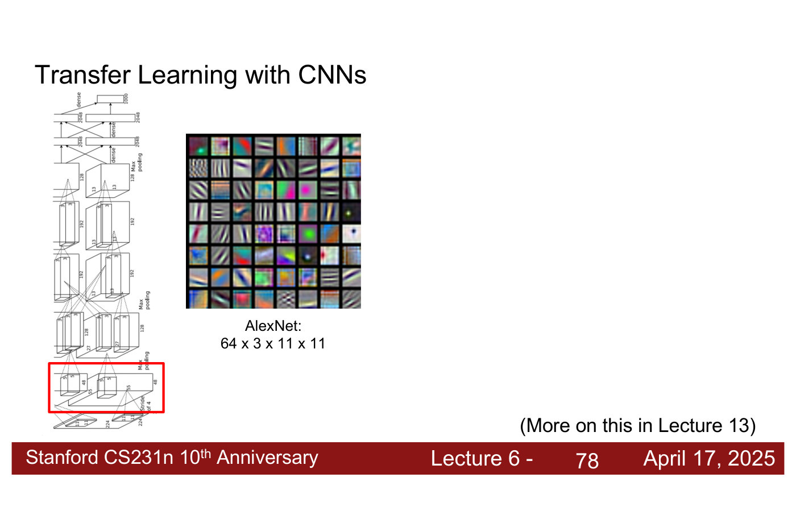
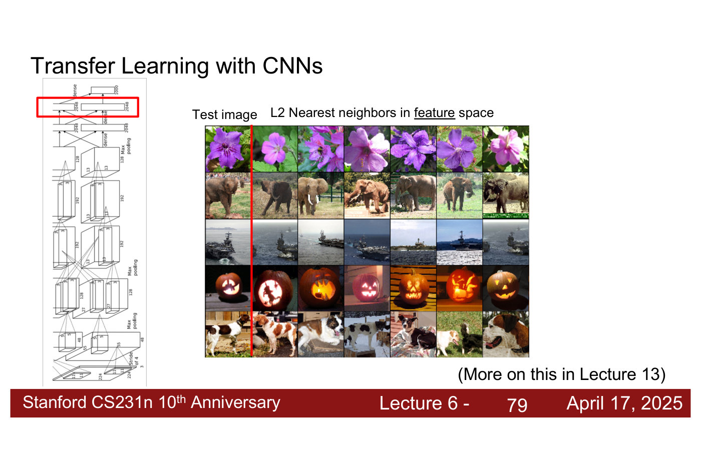
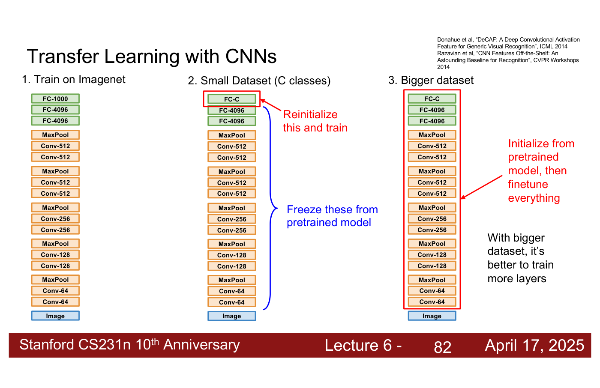
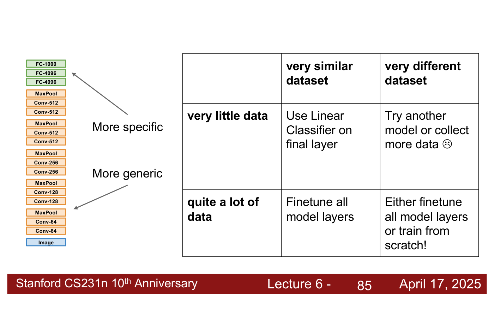

# Transfer learning

**Transfer learning** trains a model on a large dataset and then reuses it for a different, usually
smaller, one. It is how CNNs can be trained without a million images of your own. The course covers
it in [lecture 6](06-training-cnns-architectures.md#transfer-learning) (Zane Durante, April 17,
2025), which presents it as the exact thing to do for a course project. Citations "lecture 6,
slide N" are to the [lecture 6 slide file](../raw/slides/06-training-cnns-architectures.md), and
timestamps "(lecture 6, ≈M:SS)" to the
[lecture 6 transcript](../raw/transcripts/06-training-cnns-architectures.md).

## The problem

ImageNet's original version had a million images, and almost nobody has that many for their own
problem. Can you still train CNNs without a lot of data? Yes, but you have to be smart about it
(lecture 6, ≈57:46–58:33).

## Why it works: what a trained network's features capture

A trained CNN builds a hierarchy of features. Its first layer detects edges, patterns and small
shapes: the deck shows AlexNet's first-layer filters, 64 x 3 x 11 x 11 (lecture 6, slide 78). At the
other end, take the vector the network produces just before its class scores — the 4096- or
2048-dimensional layer — and compare images by the L2 distance between their vectors. A test
image's nearest neighbours in that feature space are images of the same category (lecture 6,
slide 79). This is the [nearest-neighbour](k-nearest-neighbors.md) idea from lecture 2, applied to
learned features rather than pixels. It means a linear or $k$-nearest-neighbour classifier built on
those features would classify very well (lecture 6, ≈58:33–1:00:05).

*Lecture 6, slide 78 — AlexNet's first layer (boxed in the network diagram) and its filters, 64 x 3 x 11 x 11: oriented edges, colour blobs and gratings. [Deck](https://cs231n.stanford.edu/slides/2025/lecture_6.pdf)*

*Lecture 6, slide 79 — test images (left of the red line) and their six nearest neighbours by L2 distance in the feature space of the boxed last hidden layer: flowers, elephants, ships, jack-o'-lanterns and dogs. [Deck](https://cs231n.stanford.edu/slides/2025/lecture_6.pdf)*

## Three ways to use a pretrained network

The deck gives three steps (lecture 6, slides 80–82, after Donahue et al., "DeCAF", ICML 2014, and
Razavian et al., "CNN Features Off-the-Shelf", CVPR Workshops 2014).

*Lecture 6, slide 82 — three steps: train on ImageNet; for a small dataset, freeze everything and retrain a new final FC-C layer; for a bigger one, initialise from the pretrained model and finetune everything. [Deck](https://cs231n.stanford.edu/slides/2025/lecture_6.pdf)*

**First, train on ImageNet** or internet-scale data, or take a model someone else has trained.

**For a small dataset, freeze the network and retrain the last layer.** With $C$ classes, replace
the final layer, FC-1000, with a new FC-C layer, "reinitialize this and train", and "freeze these
from pretrained model" for every other layer (lecture 6, slide 81). The new layer is initialised
randomly with [Kaiming initialization](weight-initialization.md); the frozen layers keep their
values and gradient descent never changes them. Each image goes through the frozen model to a
4096-dimensional vector, and only the mapping from that vector to the classes is trained, almost
like a linear classifier on those vectors (lecture 6, ≈1:00:05–1:00:51, ≈1:01:37–1:02:22). The
frozen network acts as a predefined feature extractor, much like the hand-designed features of the
older paradigm (see
[image classification](image-classification.md#hand-designed-features-and-end-to-end-learning)),
on top of which a model is trained (lecture 6, ≈1:00:51).

**For a bigger dataset, initialise from the pretrained model, then finetune everything**: "with
bigger dataset, it's better to train more layers" (lecture 6, slide 82). This is what the lecturer
does for almost every problem he works on. With a million or ten million examples of his own, he
starts from a model trained on billions, which he would not have the compute to train, and
finetunes the whole model. The pretrained model has seen more data and is a better feature
extractor, and finetuning makes it specific to the problem (lecture 6, ≈1:00:51–1:01:37).

## Which strategy, when

| | very similar dataset | very different dataset |
| --- | --- | --- |
| **very little data** | Use Linear Classifier on final layer | Try another model or collect more data :( |
| **quite a lot of data** | Finetune all model layers | Either finetune all model layers or train from scratch! |

The deck draws this table beside the network, marking the layers near the input "more generic" and
those near the output "more specific" (lecture 6, slide 85). With a very different dataset and a lot of data, starting from the pretrained model may or may not
beat training from scratch: "you would test". With a very different dataset and very little data,
look for a model trained on something closer. Out-of-domain generalisation is an active research
area, and some models generalise across domains better than others, but no general technique always
works. It is by far the hardest setting to train a model in; for the other three cells the
strategies work well in practice (lecture 6, ≈1:03:55–1:04:40).

*Lecture 6, slide 85 — the four-case table beside the network, whose layers near the input are more generic and near the output more specific. [Deck](https://cs231n.stanford.edu/slides/2025/lecture_6.pdf)*

**A pretrained model carries its training data's bias.** A frozen ImageNet model does best on data
that looks like ImageNet, everyday objects, people and places, and much worse on, say, photos of
Mars. Choose a pretrained model whose data has the same kinds of objects or locations as yours
(lecture 6, ≈1:02:22–1:03:55).

**In between** freezing everything but the last layer and finetuning everything, people have
trained subsets of the layers. **LoRA** finetunes all the layers, but by learning low-rank
differences from the original weights with a very small number of parameters, "sort of like how a
ResNet, you're learning the difference" (lecture 6, ≈1:04:40–1:05:27).

## For your project

"Have some dataset of interest but it has < ~1M images?" Find a very large dataset with similar
data and train a big model there, then transfer learn to your dataset. Frameworks provide "model
zoos" of pretrained models so that you need not train your own: PyTorch's torchvision
(<https://github.com/pytorch/vision>) and Hugging Face's PyTorch image models
(<https://github.com/huggingface/pytorch-image-models>) (lecture 6, slide 86; ≈1:06:13–1:06:59).

Lecture 7's image captioning model is built the same way: a CNN pretrained on ImageNet with its
last two layers (FC-1000 and softmax) removed, so that its second-to-last layer feeds a recurrent
network that writes the caption. "This is sort of the common strategy we saw for transfer learning
as well, for getting good visual representations of images" (lecture 7, slides 88–91; ≈51:52). See
[image captioning](image-captioning.md#how-the-cnn-and-the-rnn-are-joined).

## Lectures

- [Lecture 6 — Training CNNs and CNN Architectures](06-training-cnns-architectures.md#transfer-learning):
  everything on this page.
- [Lecture 2 — Image Classification with Linear Classifiers](02-image-classification.md): the
  nearest-neighbour and linear classifiers that a frozen network's features feed.
- [Lecture 7 — Recurrent Neural Networks](07-recurrent-neural-networks.md#image-captioning): a
  pretrained CNN's second-to-last layer as the image input to a captioning RNN.
- [Lecture 9 — Detection, Segmentation, Visualization, and Understanding](09-detection-segmentation-visualization.md): an
  ImageNet-pretrained ConvNet inside R-CNN, backbone networks in Fast R-CNN, and "Finetune on your
  own dataset with pre-trained models" for detectors (lecture 9, slides 82, 88 and 124).
- [Lecture 10 — Video Understanding](10-video-understanding.md#inflating-2d-networks-to-3d-i3d): the
  released C3D model as a video feature extractor (lecture 10, slide 40), and I3D, which initializes
  a 3D network from 2D ImageNet weights by copying each kernel along time; on Kinetics-400,
  ImageNet pretraining improves every model compared (lecture 10, slides 75–76).

## Related pages

- [CNN architectures](cnn-architectures.md) — the pretrained networks usually reused.
- [Data preprocessing and augmentation](data-augmentation.md) — the other remedy for a small
  dataset.
- [ImageNet](imagenet.md) — the dataset most pretrained models come from.
