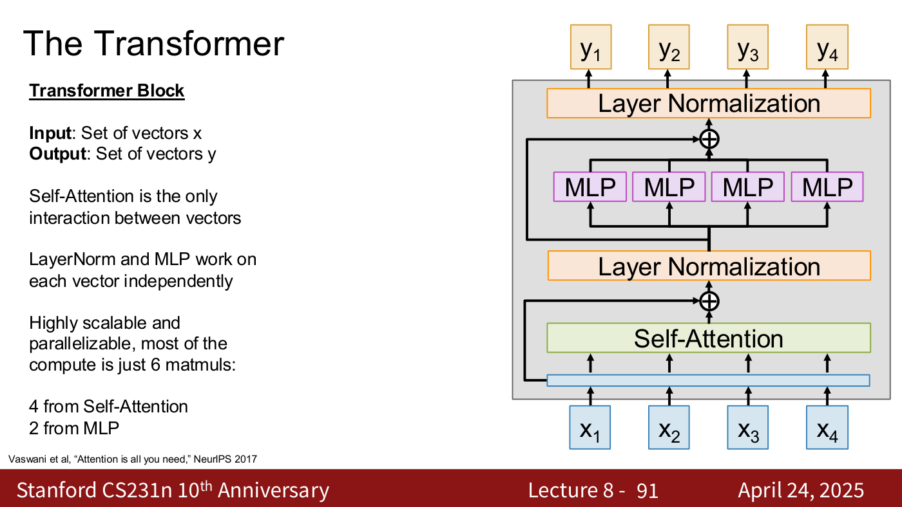
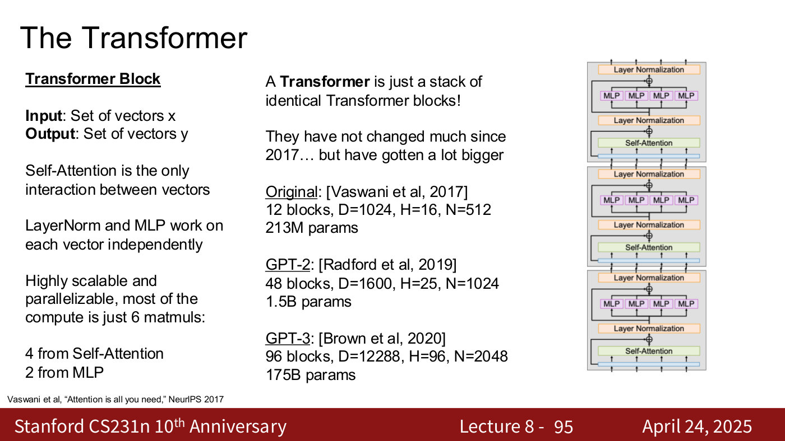
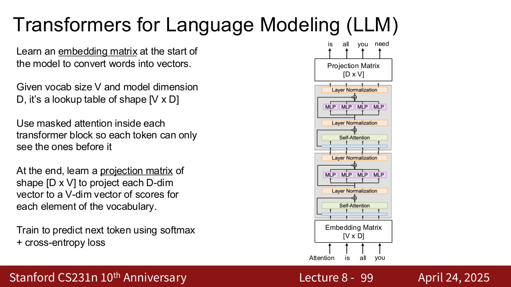
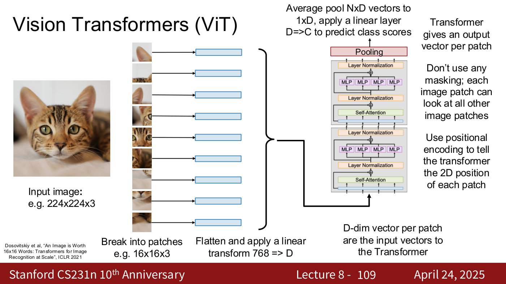
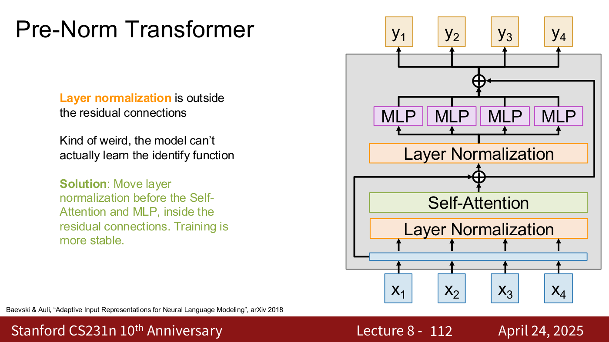
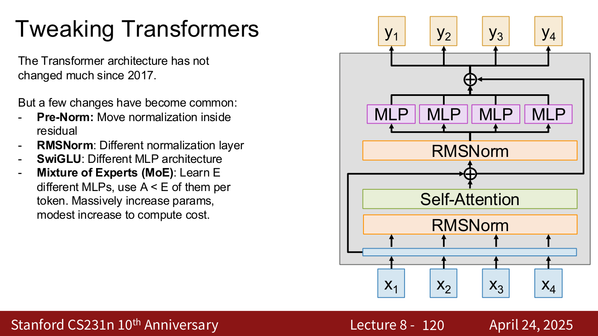

# Transformers

The **Transformer** is "a neural network architecture that uses attention everywhere"
(lecture 8, slide 4): a stack of identical blocks, each letting a set of vectors exchange
information through self-attention and then processing every vector on its own with a small MLP.
In the lecturer's words, transformers are "basically the architecture that we use for almost all
problems in deep learning today" (lecture 8, ≈1:36). The course builds it in
[lecture 8](08-attention-transformers.md) (April 24, 2025). Citations "lecture 8, slide N" are to
the [lecture 8 slide file](../raw/slides/08-attention-transformers.md), and timestamps
"(lecture 8, ≈M:SS)" to the [lecture 8 transcript](../raw/transcripts/08-attention-transformers.md).

The building block, self-attention, has its own page: [attention](attention.md).

## The Transformer block

A block takes a set of vectors $x$ and outputs a set of vectors $y$ of the same number
(lecture 8, slides 84–91; ≈1:02:18–1:03:48). In order:

1. **Self-attention**, multi-headed: "All vectors interact through (multiheaded) Self-Attention"
   (slide 85).
2. A **residual connection** around it (slide 86), "for all the same reasons that we wanted to use
   residual connections in ResNets" (≈1:02:18); see
   [CNN architectures](cnn-architectures.md#resnet-residual-connections).
3. **Layer normalization**, which "normalizes all vectors" (slide 87); normalization makes
   architectures train more stably (≈1:03:03). See
   [normalization layers](normalization-layers.md#layer-normalization-in-transformers).
4. An **MLP** applied "independently on each vector" (slide 88): "usually a two-layer MLP; classic
   setup is D => 4D => D", "also sometimes called FFN (Feed-Forward Network)".
5. A second **residual connection**, around the MLP (slide 89).
6. A second **layer normalization** (slide 90).

"Self-Attention is the only interaction between vectors"; "LayerNorm and MLP work on each vector
independently". The block is "highly scalable and parallelizable, most of the compute is just 6
matmuls: 4 from Self-Attention, 2 from MLP" (lecture 8, slide 91). The lecturer puts the division
of labour this way: self-attention "lets all the vectors talk to each other", and the MLP lets the
network "perform computation on each vector independently" (lecture 8, ≈1:03:03–1:03:48).

*Lecture 8, slide 91 — one Transformer block: self-attention, then per-vector MLPs, each inside a residual connection and followed by layer normalization. [Deck](https://cs231n.stanford.edu/slides/2025/lecture_8.pdf)*

## Stacks of blocks, and how big they have become

"A Transformer is just a stack of identical Transformer blocks!" They "have not changed much since
2017… but have gotten a lot bigger" (lecture 8, slide 92). With $D$ the vector dimension, $H$ the
number of heads and $N$ the sequence length (lecture 8, slides 93–95):

| Model | Blocks | $D$ | $H$ | $N$ | Parameters |
| --- | --- | --- | --- | --- | --- |
| Original [Vaswani et al., 2017] | 12 | 1024 | 16 | 512 | 213M |
| GPT-2 [Radford et al., 2019] | 48 | 1600 | 25 | 1024 | 1.5B |
| GPT-3 [Brown et al., 2020] | 96 | 12288 | 96 | 2048 | 175B |

The lecturer rounds the original to "something like 12 blocks, 200 million parameters", and says
transformers are now trained "with hundreds of blocks and trillions of parameters", the same
architecture scaled "across many orders of magnitude" (lecture 8, ≈1:03:48).

*Lecture 8, slide 95 — a Transformer is a stack of identical blocks; beside it, the original, GPT-2 and GPT-3 sizes. [Deck](https://cs231n.stanford.edu/slides/2025/lecture_8.pdf)*

## Language models

A transformer language model (lecture 8, slides 96–99; on the slides only, the recording
mentioning it in one sentence at ≈1:04:36) has four parts:

- an **embedding matrix** at the start, "a lookup table of shape [V x D]" for vocabulary size $V$
  and model dimension $D$, turning words into vectors;
- **masked attention** inside every block, "so each token can only see the ones before it"
  (see [masked self-attention](attention.md#masked-self-attention));
- a **projection matrix** of shape $[D \times V]$ at the end, turning each $D$-dimensional vector
  into "a V-dim vector of scores for each element of the vocabulary";
- training "to predict next token using softmax + cross-entropy loss".

*Lecture 8, slide 99 — "Attention is all you" goes in, and each position predicts the next word, "is all you need". [Deck](https://cs231n.stanford.edu/slides/2025/lecture_8.pdf)*

The recurrent version of the same task is lecture 7's
[character-level language model](language-models.md).

## Vision Transformers

The **Vision Transformer (ViT)** applies the same architecture to images (lecture 8, slides
100–109, citing Dosovitskiy et al., "An Image is Worth 16x16 Words", ICLR 2021; ≈1:04:36). Break
an image of, for example, $224 \times 224 \times 3$ into patches of, for example,
$16 \times 16 \times 3$. Flatten each patch and apply a linear transform from 768 values to $D$.
The slide notes that this is the same as a "16x16 conv with stride 16, 3 input channels, D output
channels" (slide 104; see [convolutional networks](convolutional-networks.md)). The patch vectors
are the Transformer's inputs, with a positional encoding giving "the 2D position of each patch",
and no masking, since "each image patch can look at all other image patches" (slides 105–107).
The Transformer outputs one vector per patch, and for classification the model averages those
$N \times D$ vectors to one and applies a linear layer from $D$ to $C$ class scores (slide 109).

*Lecture 8, slide 109 — patches become vectors, the Transformer gives one output per patch, and pooling plus a linear layer give the class scores. [Deck](https://cs231n.stanford.edu/slides/2025/lecture_8.pdf)*

## Later changes to the block

Four changes "have become common" since 2017 (lecture 8, slides 110–120). The recording leaves
these slides as "extra reading" (lecture 8, ≈1:05:22), so this section comes from the slides alone.

- **Pre-norm** (slides 111–112, Baevski & Auli, 2018). In the original block, layer normalization
  "is outside the residual connections", so "the model can't actually learn the identify
  function" (printed "identify"). Moving it "before the Self-Attention and MLP, inside the
  residual connections" makes training more stable.
- **RMSNorm** (slide 113, Zhang and Sennrich, 2019) replaces layer normalization; "training is a
  bit more stable". See [normalization layers](normalization-layers.md#layer-normalization-in-transformers).
- **SwiGLU** (slides 114–116, Shazeer, 2020) replaces the MLP $Y = \sigma(XW_1)W_2$ with
  $Y = (\sigma(XW_1) \odot XW_2)W_3$, and "setting H = 8D/3 keeps same total params".
- **Mixture of experts** (slides 117–119, Shazeer et al., 2017) learns $E$ MLPs per block and
  routes each token to $A \lt E$ of them, which "increases params by E, but only increases compute
  by A". The slide adds that the biggest LLMs today "almost certainly use MoE and have > 1T params;
  but they don't publish details anymore".

*Lecture 8, slide 112 — the pre-norm block: each normalization moves inside its residual branch, before self-attention and before the MLPs. [Deck](https://cs231n.stanford.edu/slides/2025/lecture_8.pdf)*

The equations and shapes for each are on the
[lecture 8 page](08-attention-transformers.md#tweaking-transformers-slides-only).

*Lecture 8, slide 120 — the four common changes, and the pre-norm block with RMSNorm they lead to. [Deck](https://cs231n.stanford.edu/slides/2025/lecture_8.pdf)*

## Why transformers took over

Lecture 8 compares self-attention with recurrence and convolution (slides 80–82; see
[attention](attention.md#attention-compared-with-recurrence-and-convolution)). Recurrent networks
cannot be parallelised along the sequence, and convolutions need many layers to see far; in one
self-attention layer every vector looks at every other, and the whole operation is a few large
matrix multiplies (lecture 8, ≈58:26–59:58). The lecturer's argument is about scale: individual
processors are hard to make faster, but algorithms that use many processors at once can keep
growing (lecture 8, ≈1:00:44–1:01:31). Lecture 7 notes the price, a context length that is
"becoming more and more of an issue" and compute quadratic in sequence length, which modern
recurrent models try to avoid (see [recurrent neural networks](recurrent-neural-networks.md#modern-rnns-state-space-models)).

"Transformers are the backbone of all large AI models today! Used for language, vision, speech, …"
(lecture 8, slide 121).

## Where the course covers transformers

- [Lecture 8 — Attention and Transformers](08-attention-transformers.md): everything on this page.
- [Lecture 7 — Recurrent Neural Networks](07-recurrent-neural-networks.md#modern-rnns) compares
  modern recurrent models with transformers.
- [Lecture 6 — Training CNNs and CNN Architectures](06-training-cnns-architectures.md) mentions
  transformers when it introduces layer normalization and residual connections.
