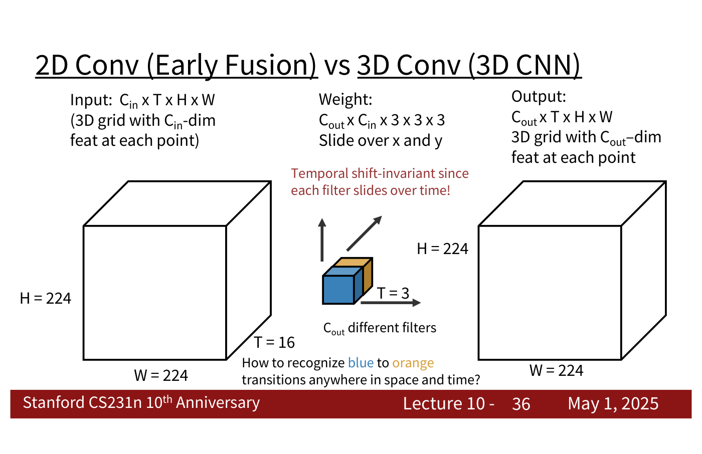
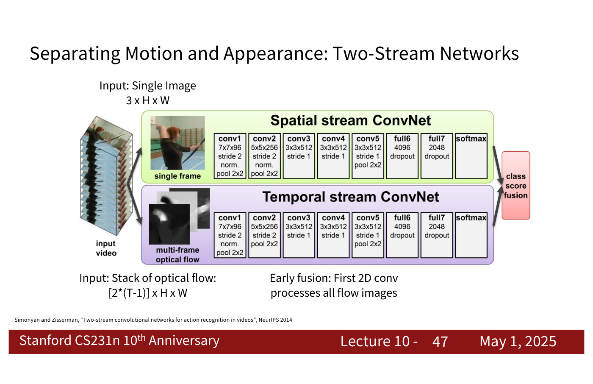

# Video understanding

A video is "a sequence of images": a 4D tensor $T \times 3 \times H \times W$ (or $3 \times T \times H \times W$), with $T$ frames of height $H$ and width $W$ (lecture 10, slide 7). Its central task, video classification, usually means recognizing *actions* rather than objects (lecture 10, ≈4:41). The course covers video in [lecture 10](10-video-understanding.md) (May 1, 2025), a guest lecture by Ruohan Gao. Citations "lecture 10, slide N" are to the [lecture 10 slide file](../raw/slides/10-video-understanding.md), and timestamps "(lecture 10, ≈M:SS)" to the [lecture 10 transcript](../raw/transcripts/10-video-understanding.md).

## Clips, not whole videos

Uncompressed video is about 1.5 GB a minute at standard definition and 10 GB a minute at HD (lecture 10, slide 10), far too much for a GPU that must also hold weights and activations. So models "train on short clips: low fps and low spatial resolution", such as 16 frames of $112 \times 112$ at 5 frames per second (3.2 seconds, 588 KB), and at test time run on several clips and average the predictions (lecture 10, slides 11–14). Each model below is a *clip* classifier; long videos are handled by aggregating clips, or by the long-term models further down.

## How a network can combine frames

The lecture's models differ in *where* information from different frames is combined.

**Single-frame CNN.** A 2D image classifier applied to each frame independently, its predicted probabilities averaged. It ignores time entirely and is still "a very, very strong baseline": "always run this first" (lecture 10, slide 15; ≈9:22).

**Late fusion.** A 2D CNN on each frame, with the features combined at the end, by concatenation and an MLP or by average pooling and a linear layer (lecture 10, slides 16–17). Concatenation makes the first fully connected layer huge; pooling may throw information away. Either way, low-level motion such as a runner's feet going up and down is "hard to compare" by then (lecture 10, slide 18; ≈14:47).

**Early fusion.** All $T$ frames stacked as $3T$ input channels, so the first 2D convolution "collapses all temporal information" and the rest is a 2D CNN (lecture 10, slide 19). "One layer of temporal processing may not be enough!" (lecture 10, slide 20)

**3D CNN ("slow fusion").** 3D convolution and pooling throughout, so temporal information is fused gradually, like spatial information (lecture 10, slides 21–23). In the lecture's toy networks the temporal receptive field grows 1, 1, 1, 20 for late fusion, 20 from the first layer for early fusion, and 3, 6, 14, 20 for the 3D CNN (lecture 10, slide 30).

The deciding difference between early fusion and a 3D CNN is **temporal shift-invariance**. Early fusion's filter extends over every frame of the clip, so the same motion at a different time needs a different filter; a 3D filter a few frames deep slides over time, so one filter detects the motion at any moment, as a 2D filter detects a pattern anywhere in an image (lecture 10, slides 32–36; ≈26:23–29:30).

*Lecture 10, slide 36 — the 3D filter is three frames deep and slides along time, so the same blue-to-orange change is detected wherever it happens in the clip. [Deck](https://cs231n.stanford.edu/slides/2025/lecture_10.pdf)*

**C3D**, "the VGG of 3D CNNs", uses $3 \times 3 \times 3$ convolutions and $2 \times 2 \times 2$ pooling throughout; at 39.5 GFLOP a clip it costs 2.9 times VGG-16 (lecture 10, slides 40–41). Its released Sports-1M model was widely used as a video feature extractor (lecture 10, ≈36:26–37:12).

## Motion as an input: optical flow and two streams

Optical flow is a displacement field between two frames, $F(x, y) = (dx, dy)$ with $I_{t+1}(x+dx, y+dy) = I_t(x, y)$: where each pixel of frame $t$ moves in frame $t+1$ (lecture 10, slide 45). A **two-stream network** classifies appearance from a single frame and motion from a stack of flow fields, and fuses the two streams' class scores (lecture 10, slide 47). On UCF-101 the motion stream alone (83.7) beats the appearance stream alone (73), and the fused network does best (86.9 by averaging, 88 by an SVM) (lecture 10, slide 48). The lecturer's hypothesis: motion is less prone to overfitting to the background (lecture 10, ≈44:54).

*Lecture 10, slide 47 — the spatial stream (green) sees one frame, the temporal stream (purple) a stack of optical-flow images; their class scores are fused. [Deck](https://cs231n.stanford.edu/slides/2025/lecture_10.pdf)*

## Longer time spans

Clip models see only "~2-5 seconds" (lecture 10, slide 49). Three ways to reach further:

- **CNN features into an RNN or LSTM**, many to one for a label per video or many to many for a label per frame, often with the CNN frozen as a pretrained feature extractor (lecture 10, slides 51–55; see [recurrent neural networks](recurrent-neural-networks.md)).
- **Recurrent convolutional networks**, which replace every matrix multiply of an RNN with a 2D convolution, so each layer's feature map depends on the same layer at the previous step and the layer below at the same step (lecture 10, slides 58–61). They were "not used too much", because RNNs cannot be parallelized over long sequences (lecture 10, slide 63; ≈51:09).
- **Self-attention over space and time**: the **nonlocal block** computes queries, keys and values with $1 \times 1 \times 1$ convolutions, attends between every pair of the $THW$ space-time positions, and adds the result back to its input; it can be inserted between the stages of a 3D CNN (lecture 10, slides 65–71; see [attention](attention.md)).

## Reusing image models

**I3D** inflates a 2D architecture to 3D, replacing each $K_h \times K_w$ convolution or pooling with a $K_t \times K_h \times K_w$ one, and initializes the 3D kernels from the 2D weights by copying each kernel $K_t$ times along time and dividing by $K_t$, which reproduces the 2D output on a "constant" video (lecture 10, slides 72–75; see [transfer learning](transfer-learning.md)). On Kinetics-400 with Inception networks, ImageNet pretraining helps every model, and the inflated two-stream network does best, 74.2 top-1 (lecture 10, slide 76).

Video transformers continue the line: factorized space and time attention, pooling of tokens (MViT), and video masked autoencoders for pretraining (lecture 10, slide 77; see [transformers](transformers.md)). Kinetics-400 top-1 accuracy rises from the per-frame CNN's 62.2 to 90 for VideoMAE V2-g (lecture 10, slide 78).

## Data sets

| Data set | What the lecture says | Where |
| --- | --- | --- |
| Sports-1M | 1 million YouTube videos, 487 sports; released as a list of URLs, many since gone | lecture 10, slide 38; ≈34:53 |
| UCF-101 | 101 action categories | lecture 10, slide 48; ≈44:09 |
| Kinetics-400 | "a large video data set"; top-1 accuracy compared on slides 76 and 78 | lecture 10, ≈58:54 |
| AVA | people localized in space and time with atomic actions | lecture 10, slide 86 |

Results quoted in the lecture: on Sports-1M top-5 accuracy, single frame 77.7, early fusion 76.8, late fusion 78.7, 3D CNN 80.2, C3D 84.4 (lecture 10, slides 39 and 42).

## Beyond classifying clips

- **Temporal action localization**: find the frames of each action in an untrimmed video, with temporal proposals then classification, as in Faster R-CNN (lecture 10, slide 85; see [object detection](object-detection.md)).
- **Spatio-temporal detection**: detect the people in space and time and classify their actions (lecture 10, slide 86).
- **Visualization**: gradient ascent on a class score for a two-stream network's appearance and flow inputs, with a smoothness penalty that separates slow from fast motion (lecture 10, slides 79–81; see [visualizing what networks learn](visualizing-networks.md)).
- **Audio**: visually guided separation of speakers or instruments, and audio-visual transformers and masked autoencoders (lecture 10, slides 92–97).
- **Efficiency**: cheaper clip models (X3D), choosing salient clips (SCSampler), choosing modalities (AdaMML) and previewing with audio (lecture 10, slides 98–100).
- **Egocentric video** from smart glasses, and **video with LLMs** (lecture 10, slides 101–102).

## Where the course covers video

- [Lecture 10 — Video Understanding](10-video-understanding.md): everything on this page.
- [Lecture 9 — Detection, Segmentation, Visualization, and Understanding](09-detection-segmentation-visualization.md): the image-level detection and visualization methods lecture 10 extends to video.
