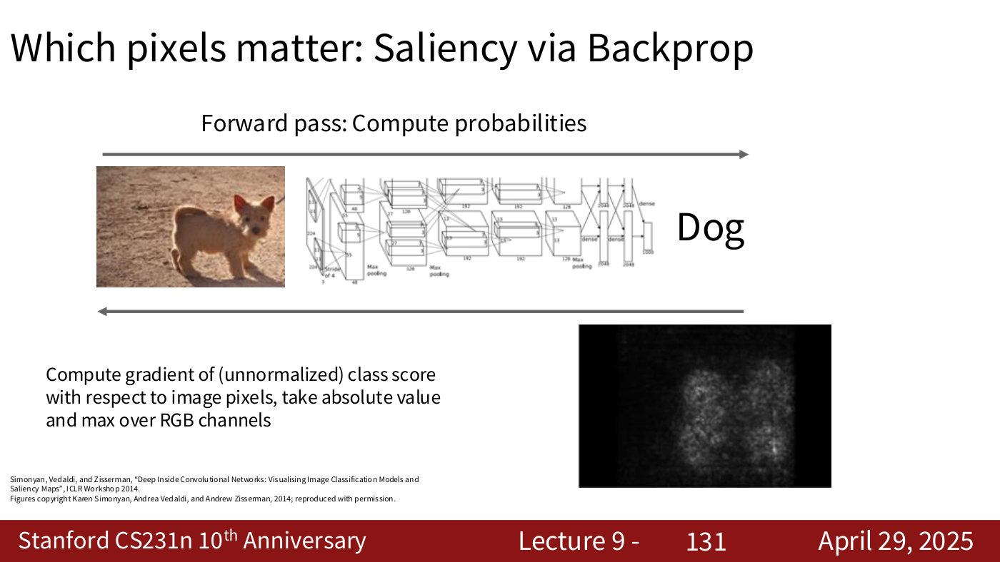
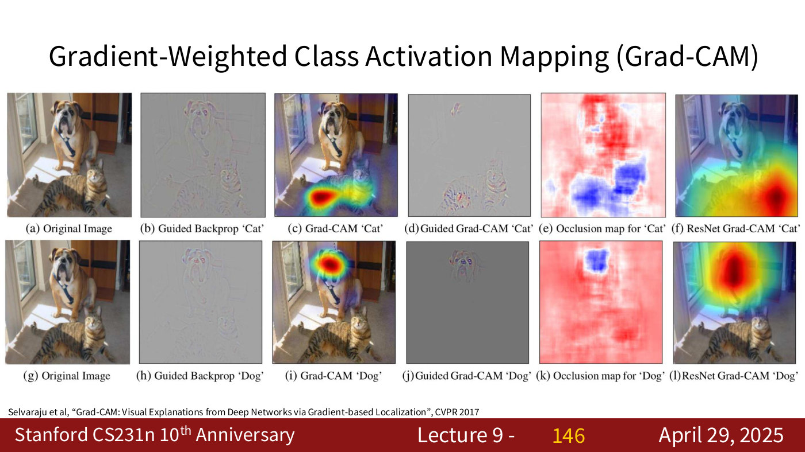

# Visualizing what networks learn

Two questions run through this topic: what has a trained network learned, and which parts of an input drove a particular decision? Visualizing networks "helped us gain understanding into what the networks are learning" (lecture 9, ≈1:01:20–1:02:09). In medicine "often the visualization and understanding is more important than the classification itself … You want to know where, why" (lecture 9, ≈16:29). The course covers it in the last part of [lecture 9](09-detection-segmentation-visualization.md#visualization-and-understanding) (April 29, 2025), drawing on earlier lectures. Citations "lecture 9, slide N" are to the [lecture 9 slide file](../raw/slides/09-detection-segmentation-visualization.md), and timestamps "(lecture 9, ≈M:SS)" to the [lecture 9 transcript](../raw/transcripts/09-detection-segmentation-visualization.md).

## What the weights look like

**Templates.** A linear classifier's weights, one row per class, can be shown as images: each is "a template" for its class, such as a front-facing car (lecture 9, slide 127, recalling lecture 2; see [linear classifiers](linear-classifiers.md#three-ways-to-read-it)). As printed, slide 127's ship score of 61.95 leaves out the bias; with the bias it is 60.75.

**First-layer filters.** A CNN's first-layer filters can be shown the same way, because they have three input channels that map to RGB. AlexNet's $64 \times 3 \times 11 \times 11$ filters and the $64 \times 3 \times 7 \times 7$ filters of ResNet-18, ResNet-101 and DenseNet-121 show oriented edges and colour blobs (lecture 9, slides 128–129; lecture 6, slide 78; [what the filters learn](convolutional-networks.md#what-the-filters-learn)). Deeper layers have too many channels to show "in something that we can see" (lecture 9, ≈1:03:41).

## Which pixels matter

**Saliency maps** (Simonyan, Vedaldi and Zisserman, 2014). Training differentiates the class score with respect to the weights; a saliency map differentiates it with respect to the pixels. "Compute gradient of (unnormalized) class score with respect to image pixels, take absolute value and max over RGB channels" (lecture 9, slide 131). The pixels with large gradients are those that, if changed, would change the score most — "the pixels that matter in order to classify dog on this image" (lecture 9, ≈1:06:02). It is [backpropagation](backpropagation.md) run to the input instead of the weights.

*Lecture 9, slide 131 — a saliency map: the gradient of the dog score with respect to each pixel, its absolute value maxed over the colour channels, is brightest over the dog. [Deck](https://cs231n.stanford.edu/slides/2025/lecture_9.pdf)*

**Class activation mapping (CAM)** (Zhou et al., 2016). When the last convolutional features $f \in \mathbb{R}^{H \times W \times K}$ are global-average-pooled and fed to one linear layer with weights $w \in \mathbb{R}^{K \times C}$, each class score $S_c$ is the spatial average of a map

$$M_{c,h,w} = \sum_k w_{k,c} f_{h,w,k}$$

which shows where in the image the evidence for class $c$ lies (lecture 9, slides 133–140). Its limitation: "Can only apply to last conv layer" (lecture 9, slide 141).

**Grad-CAM** (Selvaraju et al., 2017) works at any layer with activations $A \in \mathbb{R}^{H \times W \times K}$. It average-pools the gradient of the class score over space to get one weight per channel, $\alpha_k = \frac{1}{HW} \sum_{h,w} \partial S_c / \partial A_{h,w,k}$, and takes $M^c_{h,w} = \mathrm{ReLU}\left(\sum_k \alpha_k A_{h,w,k}\right)$ (lecture 9, slides 142–145). The gradients carry the class signal back through whatever layers sit between the feature map and the score (lecture 9, ≈1:10:40–1:11:28).

*Lecture 9, slide 146 — Grad-CAM for Cat (top) and Dog (bottom) on one photograph: guided backprop, Grad-CAM, guided Grad-CAM, occlusion and ResNet Grad-CAM, each heat map over the named animal. [Deck](https://cs231n.stanford.edu/slides/2025/lecture_9.pdf)*

**Guided backpropagation** (Springenberg et al., 2015) visualizes a single intermediate neuron: take the gradient of its value with respect to the image pixels, but "only backprop positive gradients through each ReLU", which makes the images "come out nicer" (lecture 9, slides 175–176, not presented in the recording beyond a mention at ≈1:03:41). Beside each neuron's maximally activating patches it shows the strokes, eyes, text or faces the neuron responds to (lecture 9, slides 177–178). The worked ReLU example is on the [lecture 9 page](09-detection-segmentation-visualization.md#intermediate-features-via-guided-backpropagation-slides-only).

## Attention maps

Transformers "inherently come with the activation maps": the attention weights already say which inputs each output used, as in lecture 8's English–French attention heatmap, and for a Vision Transformer they can be mapped back to the pixels (lecture 9, slide 147; ≈1:12:14–1:13:01). "With ViTs and transformers this is much easier … but with CNNs we often use Grad-CAM or these types of algorithms" (lecture 9, ≈1:13:01). See [attention](attention.md) and lecture 8's [attention heatmaps](08-attention-transformers.md#visualising-attention-weights).

## Where the course covers visualization

- [Lecture 1 — Introduction](01-introduction.md): visualization and understanding named as a task ([computer vision tasks](computer-vision-tasks.md#tasks-over-time-and-across-modalities)).
- [Lecture 2 — Image Classification with Linear Classifiers](02-image-classification.md): the linear classifier's templates.
- [Lecture 6 — Training CNNs and CNN Architectures](06-training-cnns-architectures.md#transfer-learning): AlexNet's first-layer filters.
- [Lecture 8 — Attention and Transformers](08-attention-transformers.md): attention heatmaps.
- [Lecture 9 — Detection, Segmentation, Visualization, and Understanding](09-detection-segmentation-visualization.md#visualization-and-understanding): everything on this page.
- [Lecture 12 — Self-Supervised Learning](12-self-supervised-learning.md): nearest neighbours in feature space as the case for learned features, attention maps comparing a supervised network with a rotation-trained one, and DINO's [CLS]-token attention, which segments objects without labels.
- [Lecture 10 — Video Understanding](10-video-understanding.md#visualizing-video-models): gradient ascent on a two-stream video model's appearance and flow inputs, with a smoothness penalty that separates slow from fast motion ("Bar Shaking" and "Push overhead" for weightlifting; lecture 10, slides 79–81); and 3D CNN filters viewed as video clips (lecture 10, slide 37).
