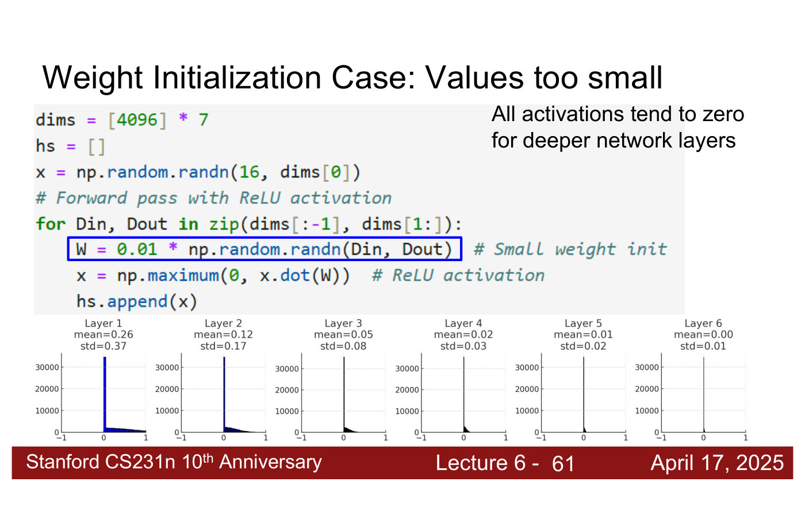
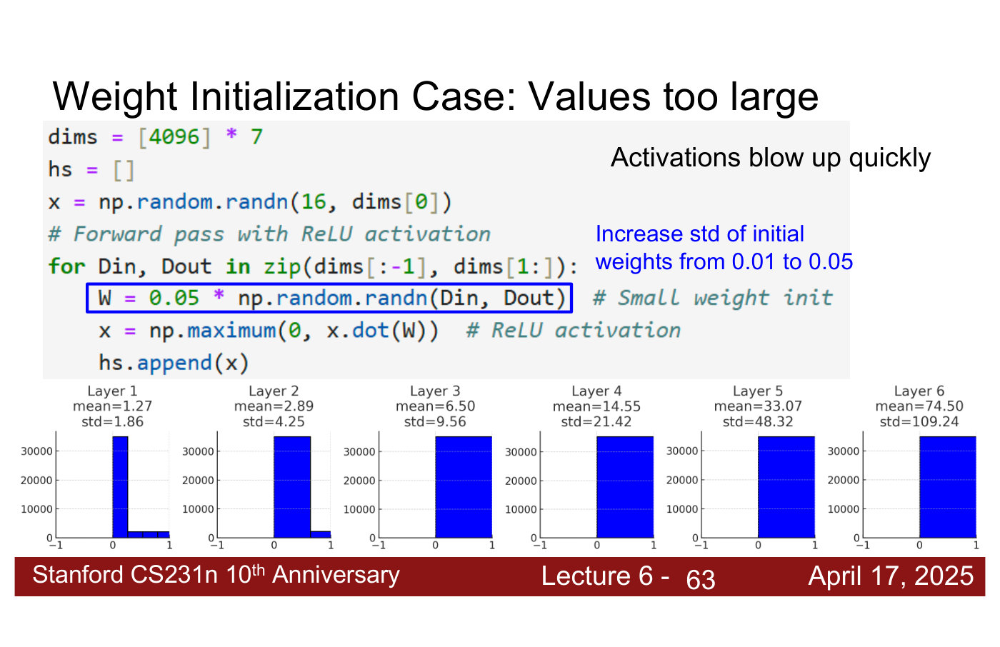
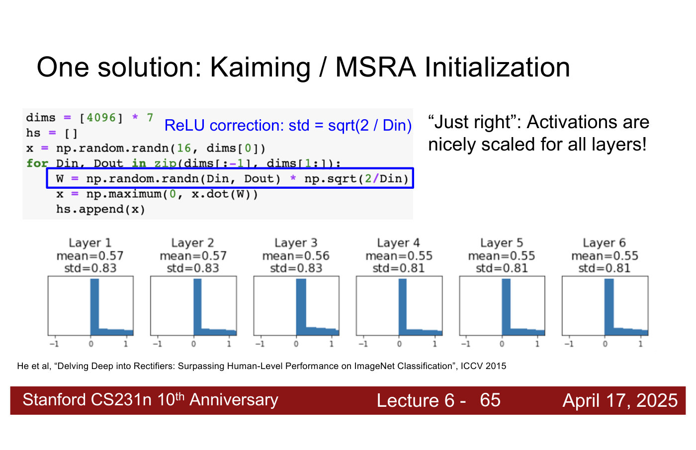

# Weight initialization

Before training starts, every weight in a network needs an initial value. If the values are too
small, the activations shrink towards zero layer by layer; if they are too large, the activations
blow up. The course covers this in
[lecture 6](06-training-cnns-architectures.md#weight-initialization) (Zane Durante, April 17,
2025) as the last step in setting up a CNN for training. Citations "lecture 6, slide N" are to the
[lecture 6 slide file](../raw/slides/06-training-cnns-architectures.md), and timestamps
"(lecture 6, ≈M:SS)" to the
[lecture 6 transcript](../raw/transcripts/06-training-cnns-architectures.md).

## The experiment

The deck runs one experiment three ways: a forward pass through a 6-layer fully connected network
with hidden size 4096 and ReLU activations, on a batch of 16 random inputs, with each layer's
weights drawn from a unit Gaussian and multiplied by a scale (lecture 6, slide 60). It plots a
histogram of each layer's activations, with their mean and standard deviation. Ideally the mean
and standard deviation would stay the same in every layer, because that makes the optimisation
much nicer to solve (lecture 6, ≈43:09). The means are positive because the outputs are ReLUs
(lecture 6, ≈42:23).

## Too small

With a scale of 0.01, "all activations tend to zero for deeper network layers" (lecture 6,
slide 61). Across the six layers the mean falls from 0.26 through 0.12, 0.05, 0.02 and 0.01 to
0.00, and the standard deviation from 0.37 through 0.17, 0.08, 0.03 and 0.02 to 0.01 (lecture 6,
≈42:23–43:09).

*Lecture 6, slide 61 — weights scaled by 0.01: across six 4096-wide ReLU layers the activations' mean falls from 0.26 to 0.00 and their std from 0.37 to 0.01. [Deck](https://cs231n.stanford.edu/slides/2025/lecture_6.pdf)*

## Too large

With a scale of 0.05, activations "blow up quickly" (lecture 6, slide 63). The mean grows from
1.27 through 2.89, 6.50, 14.55 and 33.07 to 74.50, and the standard deviation from 1.86 through
4.25, 9.56, 21.42 and 48.32 to 109.24. In a 152-layer ResNet that "becomes quite an issue very
quickly" (lecture 6, ≈43:09–43:54).

*Lecture 6, slide 63 — weights scaled by 0.05: the activations blow up, mean from 1.27 to 74.50 and std from 1.86 to 109.24 over six layers. [Deck](https://cs231n.stanford.edu/slides/2025/lecture_6.pdf)*

Why does it explode? A ReLU does not cap its output, and every layer multiplies by another set of
random values that are too large. The lecturer compares it to a recurrence relation whose factor
you would want to be one: here what matters is the dimension of the vector being multiplied, and
removing the negative half of a wide distribution at each ReLU pushes the outputs more and more
positive. He had no slides for this and points to the paper (lecture 6, ≈46:57–48:28).

## Just right: Kaiming / MSRA initialization

The right scale "depends on the size of the layer" (lecture 6, slide 64). Initialization schemes
are a function of the layer's dimension, so a 4096-dimensional fully connected layer gets a
different scale from a 2048-dimensional one (lecture 6, ≈43:54). **Kaiming initialization**
(also called MSRA initialization; He et al., "Delving Deep into Rectifiers", ICCV 2015) draws
each weight from a unit Gaussian and multiplies it by

$$\sqrt{2 / D_{\text{in}}}$$

where $D_{\text{in}}$ is the layer's input dimension: "ReLU correction: std = sqrt(2 / Din)". With
it the six histograms look nearly identical, with means 0.57, 0.57, 0.56, 0.55, 0.55, 0.55 and
standard deviations 0.83, 0.83, 0.83, 0.81, 0.81, 0.81: "'Just right': Activations are nicely
scaled for all layers!" (lecture 6, slide 65). For this network $D_{\text{in}} = 4096$, so the
scale is $\sqrt{2/4096} \approx 0.0221$, close to the "0.022 or something" the lecturer guesses
for it (lecture 6, ≈43:54).

*Lecture 6, slide 65 — std = sqrt(2 / Din): the six histograms are nearly identical, mean 0.55–0.57 and std 0.81–0.83 in every layer. [Deck](https://cs231n.stanford.edu/slides/2025/lecture_6.pdf)*

The paper shows that with a ReLU activation this keeps the mean and standard deviation of the
activations roughly constant through the layers. The lecture does not derive it: "you can almost
think of this as a magic formula where if you plug it in, you get the desired properties"
(lecture 6, ≈44:40–45:26). Kaiming He is also the first author of ResNet (lecture 6, ≈44:40; see
[CNN architectures](cnn-architectures.md#resnet-residual-connections)). For any given setup one
could also find a good scale by testing (lecture 6, ≈45:26).

## In practice

**Convolution layers** use the same formula, with the input dimension being the number of values
in each operation: for a $3 \times 3$ kernel over six input channels, $3 \cdot 3 \cdot 6$. Some
layers use different schemes (lecture 6, ≈46:12).

**How do you know it is right?** The activations' means and standard deviations stay roughly
constant through the layers, instead of collapsing to zero or blowing up. In practice people use
the formula. Only a new kind of layer nobody has used before would call for trying several schemes
to see which works best (lecture 6, ≈51:34–53:10).

**In transfer learning**, the new final layer that replaces a pretrained network's classifier is
initialised randomly with Kaiming initialization (lecture 6, ≈1:02:22; see
[transfer learning](transfer-learning.md)).

**Normalization** layers would also stop activations blowing up, but the network might still be
harder to optimise (lecture 6, ≈48:28; see [normalization layers](normalization-layers.md)).

## Can normalization replace good initialization?

No, according to lecture 7's answer to a question from lecture 6 (lecture 7, slides 7–10;
≈0:51–2:24). In a toy experiment, adding LayerNorm to a badly initialized network removed most of the
damage, but "to get the best performance you still need good weight initialization": a gap remained
between the badly and well initialized runs, both with LayerNorm. See
[normalization layers](normalization-layers.md#normalization-and-initialization).

## Lectures

- [Lecture 6 — Training CNNs and CNN Architectures](06-training-cnns-architectures.md#weight-initialization):
  everything on this page except the last section.
- [Lecture 7 — Recurrent Neural Networks](07-recurrent-neural-networks.md#clarifications-from-last-time):
  initialization with and without LayerNorm.

## Related pages

- [Neural networks](neural-networks.md) — the fully connected layers of the experiment.
- [Backpropagation](backpropagation.md) — how gradients flow through the layers being
  initialised.
- [CNN architectures](cnn-architectures.md) — the deep networks that need it.
